PLUGINS · VOICE · WORLDLINES

# Hi, I'm Shennoter.

**Per aspera ad astra.**

兴趣使然地写聊天机器人插件

  
  
  
  

[插件作品](#插件作品) · [更多探索](#更多探索) · [全部仓库](https://github.com/Shennoter?tab=repositories)

## 插件作品

从 Kotlin 的 mirai-console 到 Python 的 AstrBot ，做一些能在聊天里用上的插件。

<table>
<tr>
<td width="50%" valign="top">

<h3>◉ 阿里云 TTS 助手</h3>

PYTHON / ASTRBOT / SPEECH

接入阿里云百炼语音服务，支持文字朗读、音色创建、随机语音回复，以及 WebUI 生成与试听。

<a href="https://github.com/Shennoter/astrbot_plugin_qwen_audio_tts"><strong>探索语音插件 →</strong></a>

</td>
<td width="50%" valign="top">

<h3>◎ SteinsGate · 命运石之门</h3>

PYTHON / ASTRBOT / STEINS;GATE

生成辉光管世界线变动率图片，查询特殊世界线与年表；支持 D-QQ 和 LLM 自然语言调用。

<a href="https://github.com/Shennoter/astrbot_plugin_steinsgate"><strong>前往另一条世界线 →</strong></a>

</td>
</tr>
<tr>
<td width="50%" valign="top">

<h3>↗ ApexRankLookUp</h3>

KOTLIN / MIRAI / APEX LEGENDS

查询 Apex 英雄玩家信息、地图与复制器轮换、猎杀门槛和新闻，支持玩家分数与地图轮换订阅。

<a href="https://github.com/Shennoter/ApexRankLookUp"><strong>查看 Apex 查询插件 →</strong></a>

</td>
<td width="50%" valign="top">

<h3>⌘ nbnhhsh-mirai</h3>

KOTLIN / MIRAI / UTILITIES

在聊天中查询缩写含义，支持自定义指令，以及直接发送或转发消息两种回复方式。

<a href="https://github.com/Shennoter/nbnhhsh-mirai"><strong>好好说话，从解读缩写开始 →</strong></a>

</td>
</tr>
</table>

命运石之门主题的 mirai-console 插件也在这里：**[SteinsGateMirai](https://github.com/Shennoter/SteinsGateMirai)**。

## 更多探索

除了聊天机器人，也留下了一些硬件、系统和编程学习的记录。

| 方向 | 项目 | 内容 |
| :--- | :--- | :--- |
| 处理器设计 | [RISCV-CPU](https://github.com/Shennoter/RISCV-CPU) | 使用 RISC-V 指令集的单周期 CPU · VHDL |
| 固件构建 | [mir3g-ua2f-openwrt-firmware](https://github.com/Shennoter/mir3g-ua2f-openwrt-firmware) | OpenWrt / UA2F 固件云编译 · Shell |

---

</a>

在百分之一的墙的对面，我一定存在着。

**EL PSY KONGROO**

